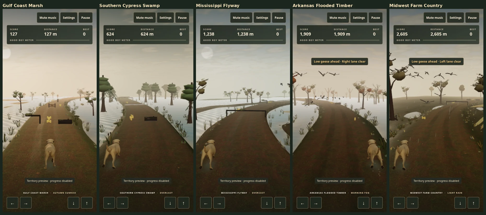
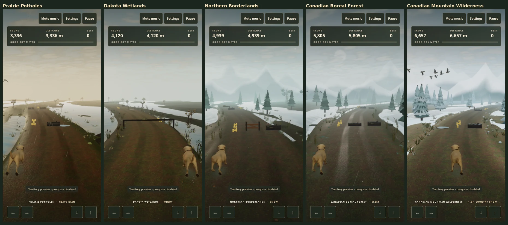
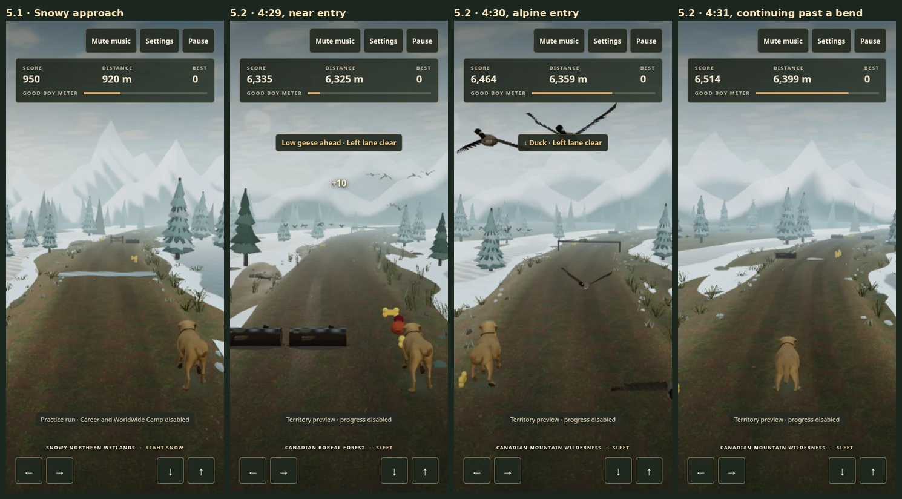

# Retriever Run 5.2 · Operation The Great Migration

The northbound course runs through ten territories in five minutes of active play. Canadian Mountain Wilderness continues into an endless northern route. The order follows the atmosphere of a waterfowl migration through North America.

## Territories

| Active time | Territory | Terrain, vegetation and landmarks | Wildlife and distant view |
| --- | --- | --- | --- |
| 0:00–0:30 | Gulf Coast Marsh | Low marsh, tidal cuts, bank reeds, weathered pilings | Teal and mallards over broad shallow water and a low treeline |
| 0:30–1:00 | Southern Cypress Swamp | Flooded ground, flared trunks, cypress knees, layered canopies | Mallards and teal among close cypress stands |
| 1:00–1:30 | Mississippi Flyway | Wide channels, exposed sandbars and stranded debris | Geese and mallards across the open river |
| 1:30–2:00 | Arkansas Flooded Timber | Autumn hardwoods, snags, brush blinds and decoys | Mallards and teal between broken timber silhouettes |
| 2:00–2:30 | Midwest Farm Country | Raised dry banks, rows of crops, a weathered barn, silo and fences | Pheasants and geese over an open agricultural skyline |
| 2:30–3:00 | Prairie Potholes | Scalloped water basins, short grasses, brush blinds and mixed decoys | Mallards and geese over open ponds and sparse trees |
| 3:00–3:30 | Dakota Wetlands | Shallow sloughs, hummocks, muskrat lodges and broken reed beds | Teal and geese across broad stretches of wet meadow |
| 3:30–4:00 | Northern Borderlands | Winding channels, rock bars, mixed woods, camp cabin, dock, canoe and jon boat | Geese and mallards under the first distant foothills |
| 4:00–4:30 | Canadian Boreal Forest | Dense spruce, pale trunks, fallen timber, raised banks and frost | Mallards and teal against darker forests and ridgelines |
| 4:30–5:00+ | Canadian Mountain Wilderness | Open channels through ice, frosted spruce, snowbanks, camps and rock cairns | Geese and teal against layered alpine ranges |

### Running-game captures

The screenshots were taken from the 5.2 runner with the dog, hazards, HUD, and collision logic active. The preview label identifies isolated capture sessions. The route panels show representative terrain in all ten territories. The mountain sequence also shows the 5.1 snowy approach for comparison. The release speeds and territory markers place the two versions at different distances.

## Timing and transitions

The simulation advances in 1/120-second steps. Territory entry uses the elapsed simulation time at each exact 30-second boundary. Pause, hidden tabs, page suspension, Lodge screens, and waiting for a terrain tile contribute no gameplay time. Resuming clears stale frame time. Terrain workers use the integrated speed curve to assign geography to world distance. Height, colors, ice and haze crossfade over 3.5 seconds on either side of entry. Adjacent tiles stage their own scenery ahead of the player. A brief highlight on the existing location label marks entry below the trail.

After the fifth minute, the last territory continues. The endgame cycles through high-country snow, alpine sun, drifting snow and river mist. Seeded camps, rock exposures and cairns vary along the same northern landscape. The underlying course keeps generating.

For local inspection, run `npm run dev` and open `?preview=8` to start at Northern Borderlands. `offset=10` starts 10 active seconds into the territory. The mode can run a normal collision and show a report, with progress awards and Camp disabled. Plain production builds ignore the preview parameter. The browser fixture uses the optimized `migration-qa` build mode on a loopback server.

## Difficulty and fairness

The first stream arrives around 3.3 seconds, after the introductory treats. Early runs usually have one blocked lane. Later stages favor narrower choices, low flights, full-width crossings, and pairs that switch from jump to slide or back. A later full-width action can lead into a forced lane change. The target base gap falls from 1.55 to 0.94 seconds before the pair, gate and goose spacing rules. The speed increases from 11 to 28.7 m/s and reaches its plateau at 4:30.

Across 100 seeds, average hazard rows per 30 seconds increased from **17.0** in the Gulf to **23.8** in Farm Country and **27.9** in Mountain Wilderness. In the same sample, rows with a switch into the sole open lane rose from **1.35** to **14.56** per interval. The final territory generated about **1.1** alternating wide-action pairs per interval. This measures what the generator presented, including safe fallbacks.

The course planner retains a safe lane at each row. It reserves 420 ms for a decision after the previous row, reserves time for the actual exponential lane response and sequential swipes, and probes full-width gates against the existing dog and hazard volumes. Gate combinations must clear both pose durations and recovery time. Invalid candidates become a safe treat row. Guided tests drive the same controls and swept solver used by gameplay, with an extra 33 ms reaction delay and jump/slide offsets on either side of the nominal timing. Physical playtesting remains necessary to judge cue legibility and comfort for human players.

The score formula, pickups, movement input, collision volumes and existing submission envelope remain compatible with the previous release. The server continues to validate the same score summary.

## Mountain and background stability

In 5.1 the ridges sat at fixed camera-relative forward offsets, while their horizontal transforms tracked different fractions of the trail's x-coordinate. Bends therefore moved each ridge sideways at a different rate from the landscape. The mesh was also shown at a hard blend threshold. Its opaque silhouette wrote depth even near the start of the fade, so a player could see a flat outline appear. Planar ridges also depended on the foreground far plane and could approach its clip boundary as the camera turned. The terrain worker never owned the mountain geometry. It was already reused, with frustum culling disabled, so rebuilding ridges, per-chunk disposal and culling did not explain the motion.

5.2 uses two permanent world-oriented arcs at radii of 345 m and 510 m, with a single horizontal origin rebase and a slowly changing, bounded forward parallax. A far-depth projection keeps this pass behind the foreground without extending the foreground clip plane. Source-alpha blending fades the silhouette in from zero, with depth writes disabled. The sky rotates with the camera independently of its translation. The terrain pool still recycles. Foreground details and distant tree instances hand off over a distance band, and distant trees fade out before the render cutoff. The tests verify that mountain transforms remain continuous across tile boundaries while both geometry objects retain their identities.

## Save and Worldwide Camp compatibility

The Field Journal shows farthest territory reached, longest active run and accumulated time in each territory for completed 5.2 runs. Existing duration records, XP, patches, cosmetics and saved Camp identity carry over. Old runs have no territory annotations. The new Flyway Traveler Field Honor records entry into Arkansas Flooded Timber, Dakota Wetlands and Canadian Mountain Wilderness. Its tiers confer no XP and do not count toward the existing promotion thresholds. The isolated preview cannot award anything. Season One database schema, standings, and authentication are untouched. Automated online runs stay on local fixtures.

## Verification and performance

The production build remains about **2.06 MB uncompressed**, compared with **2.05 MB** for 5.1. The Labrador, vest and image asset files carry forward. The world continues to share vegetation meshes and materials across tiles, with pooled foreground objects and the existing mobile presets. Mountains use two draws and 1,408 triangles while visible. The detail handoff reuses the existing tile geometries and adds overlap near the distance band.

All **92 automated tests** and the production build passed. A 10,000-session deterministic stress run completed **31,832,916 ticks**. It included **6,001 guided runs**, all of which survived their assigned duration. The four endurance runs completed 5, 10, 20 and 30 minutes. The Chromium and Linux WebKit smoke and five-size Lodge matrices passed. The production preview parameter was verified inactive. The Season One Chromium fixture covered profile recovery, offline operation, local outbox and rivals.

Benchmarks use headless Linux browsers with iPhone-sized viewports and software WebGL. The capture runner advances fixed virtual presentation steps and separately records actual wall-frame intervals. The samples describe this host and its capture workload. They cannot establish iPhone frame rates, battery use or thermal behavior.

| Chromium capture | Median draws | Median / peak triangles | Peak buffers | Median / p95 wall interval | First ready |
| --- | ---: | ---: | ---: | ---: | ---: |
| Cypress Swamp · Balanced | 41 | 143,893 / 150,985 | 8.31 MiB | 867 / 2,816 ms | 8.16 s |
| Flooded Timber · Balanced | 42 | 146,575 / 152,827 | 7.89 MiB | 1,217 / 2,783 ms | 3.10 s |
| Alpine entry · Balanced | 50 | 129,945 / 142,645 | 4.89 MiB | 883 / 2,700 ms | 1.31 s |
| Mountain · Balanced | 50 | 134,585 / 141,455 | 4.74 MiB | 300 / 833 ms | 3.49 s |
| Mountain · Battery Saver | 44 | 101,533 / 114,613 | 4.70 MiB | 1,717 / 3,283 ms | 11.43 s |
| Mountain · High | 53 | 137,503 / 150,559 | 4.85 MiB | 2,933 / 7,000 ms | 16.73 s |

The capture processes shared the host. Use the draw, triangle and buffer counts to compare rendering work across the short windows. In the densest measured 5.2 scene, peak geometry submissions were 152,827 triangles compared with 150,825 in the measured 5.1 opening. The largest single alpine transition upload observed in the final Balanced capture was 2.57 MiB. The reused textures retain the 5.1 estimate of about 6.37 MiB, excluding framebuffer and driver overhead. [5.1 baseline measurements](NORTHERN-EXPEDITION-5.1.md#performance-and-verification)

## Known limitations

Adult hunter character models are absent from the deployed 5.1 baseline and remain unimplemented. Existing blinds, decoys, equipment, boats and cabins are preserved. The browser fixtures exercise touch or keyboard interaction and page-visibility handling on Linux. The release still requires hands-on validation of iPhone Safari scrolling, real tab suspension, the difficulty curve and frame pacing.

## Physical iPhone Safari acceptance

1. On a recent and an older supported iPhone, start a clean guest run in portrait. Use one-thumb swipes and tap controls through streams, overhead branches and a late alternating pair. Confirm hazards remain readable in rain, fog and snow.
2. Pause near a territory boundary. Leave Safari for at least 30 seconds, return and resume. Confirm the territory and distance held while suspended. A successful five-minute run should enter all ten territories, then continue north.
3. In Balanced and Battery Saver, watch the ridges through two bends near Northern Borderlands and the transition into Mountain Wilderness. Check for scenery jumps, brief gaps at tile seams or unstable silhouettes.
4. Capture first-ready time, median and 95th-percentile frame intervals, draw counts and memory in Safari Web Inspector. Repeat late in a warm run with Adaptive and Battery Saver.
5. End the run, open the Field Journal, and confirm the destination, duration and territory totals. Scroll to the final item in the Kennel and Career rooms. Verify genuine Season One activity with the owner's approved staging account or normal play.
