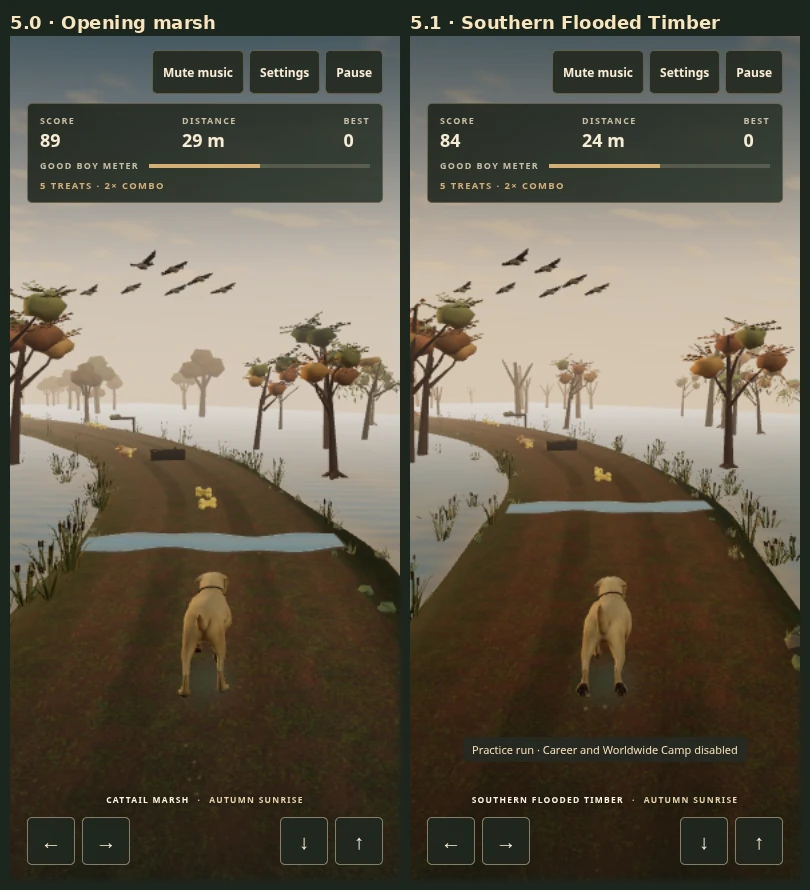
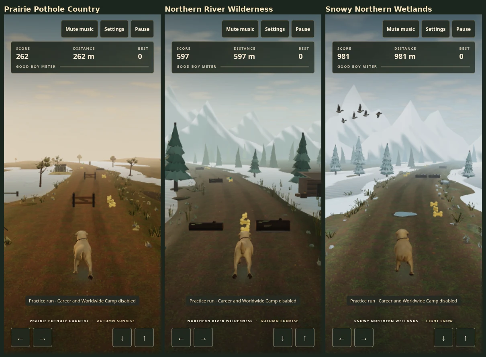
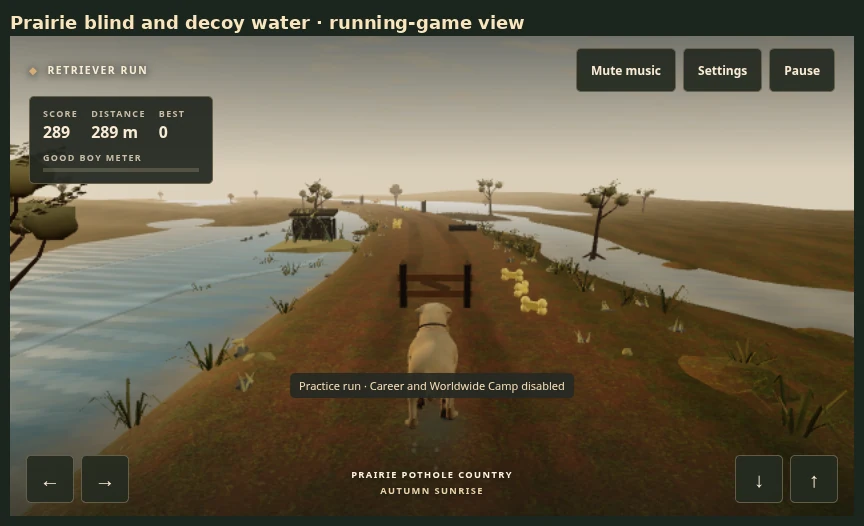
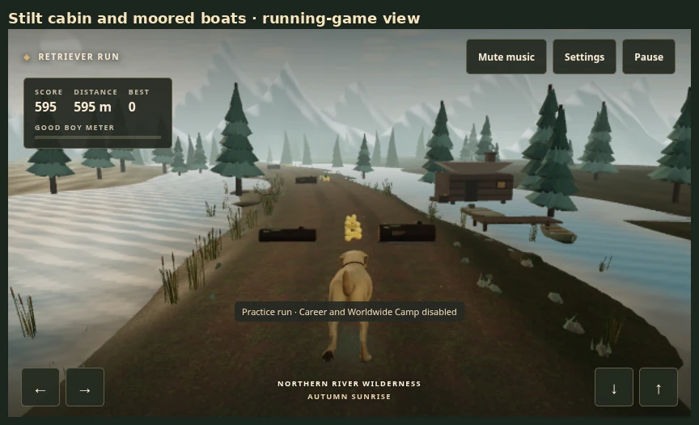
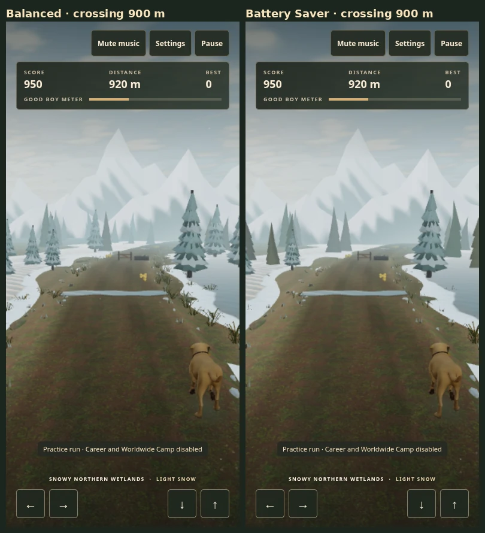
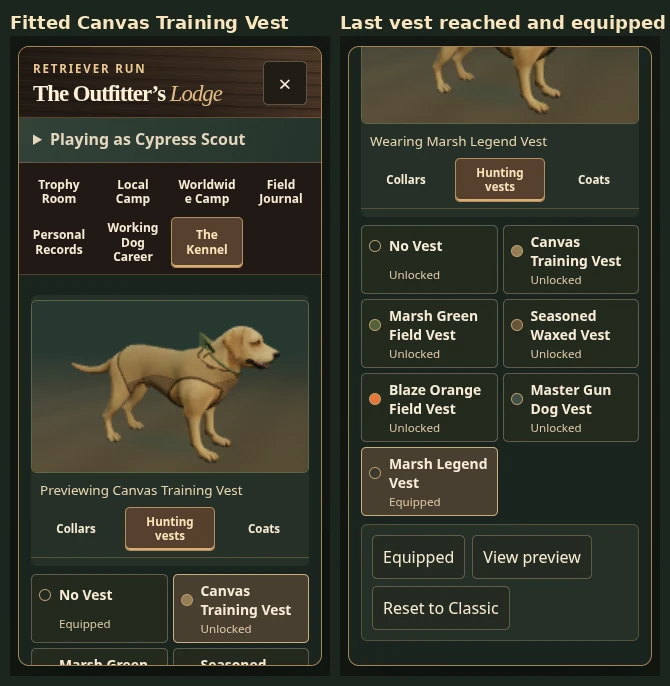

# Retriever Run 5.1 · Operation Northern Expedition

5.1 starts from merged 5.0 (`356d765`). It replaces the repeating visual habitat cycle with a continuous four-region expedition, gives Lodge rooms a reliable scrollport, reviews unsupported career ranks, and prepares Worldwide Camp Season One for owner-controlled activation. It preserves the gameplay generator, lane widths, collision volumes, score rules, save keys, anonymous identities, and local progression history. Original game assets and new procedural geometry power the release. Art purchases were **$0**.

The available 5.1 brief was the expanded brief. The implementation includes the scrolling and progression requirements it carries forward.

## Four-region journey

| Region | Marker | Terrain, water, and vegetation | Landmarks and atmosphere |
| --- | ---: | --- | --- |
| Southern Flooded Timber | 0 m | Flooded hardwood bottoms, snags, autumn leaf sprays, rooted cattails, winding shallows and dark mud | Brush-covered blinds, decoy pockets and golden morning mist |
| Prairie Pothole Country | 240 m | Scalloped basins, raised prairie shoulders, golden sedges and short wind-shaped trees | Farm buildings, weathered fencing, brush blinds and mixed decoy spreads |
| Northern River Wilderness | 540 m | Meandering side channels, stone bars, rugged banks and whorled conifers | Docks, a canoe, a flat-bottomed jon boat, a weathered stilt cabin, camp gear, lanterns, distant foothills and cooler haze |
| Snowy Northern Wetlands | 900 m onward | Frosted spruce, snow patches, rocky winter banks, frozen shallows, open channels and light snowfall | Two layered mountain silhouettes, stronger snow cover, winter camp structures and warm highlights on the snow |

Bank height, water depth, vertex color, frost and atmosphere vary smoothly over a 90 m band at each marker. Plants and landmarks remain seeded by tile and change as adjacent tiles scroll into view. The expedition remains endless in the north. The latest region and weather appear below the trail during play. The existing course controls and physics remain independent of these visual regions.

The existing skinned Labrador keeps its original mesh and working animations. The revised coat relief adds shoulder definition and smaller muzzle highlights. The ear response now eases after the stride and landing input. Fabric normal detail and bartacks add texture to the existing fitted vest. Migrating geese and ducks carry the northern backdrop with the established instanced wing rig and cue timing. The river and ice share the water material. The mountain silhouettes share two compact procedural meshes and use atmospheric color separation. Plants and distant trees remain instanced, timber near the trail retains readable silhouettes, and the settings keep Adaptive, Battery Saver, Balanced and High. Cabin smoke drifts with the wind on a shared two-triangle plane. It only draws near a visible northern cabin and turns off in Battery Saver.

### Running-game captures

The shots use the game build and seed 7. Diagnostic checkpoints select a route position in the same game and leave physics, obstacles and rendering active. The Southern comparison uses nearby distances in each release. The Prairie blind view is a wider gameplay capture. Aid overlays were hidden while the practice label and HUD stayed visible.













## Lodge scrolling

5.0 put the only scroll region on the native top-layer dialog inside the game root. The game root carries gesture handling, and Safari's visible viewport can shrink while its browser bars or keyboard are showing. A correct flex layout alone did not cover those interactions. 5.1 moves the modal outside the gameplay event surface and puts scrolling on a dedicated, keyboard-focusable inner viewport sized to the visible screen. The outer frame clips rounded edges. The Kennel grid, Field Journal and Working Dog Career use the same scroll surface. The 3D preview accepts vertical panning and continues to resize independently.

Chromium and Linux WebKit test layout and activation. A physical iPhone is still required to confirm touch inertia, browser-toolbar movement and the software keyboard.

## Career integrity

- **Marsh Legend could be legitimate at a lower displayed level.** The 4.5 migration intentionally grandfathered ranks earned under the original curve. A verified grandfathered rank still holds, and the Career page identifies carried-over progress.
- **There was also an unsupported-rank path.** The schema 3 loader accepted the saved rank string and pending ceremony without checking XP and Field Honors. The loader now verifies the rank chain and grandfathered evidence. An unsupported claim is retained as a review note and cannot trigger a ceremony or unlock new prestige gear. Existing XP, stats and records are retained.
- **Impossible journal totals are detectable, but their origin is not.** The journal checks positive running time against recorded distance, action counts, retrieves and longest run. A contradictory journal pauses new honors and promotions and shows the reason. Individual legitimate runs still save and earn XP.
- **Practice is isolated.** Diagnostics use their own records, copy only display and audio preferences on first entry, show a practice label, and never construct a Worldwide transport. The submission layer also rejects practice reports. The diagnostic checkpoint used for screenshots starts the actual runner at the selected course position and is only available in practice mode.

No affected real save was supplied. The investigation reproduced the unsupported rank and impossible totals with isolated fixtures. It cannot establish the origin of a particular player's data or authenticate arbitrary edits to browser storage.

## Worldwide Camp Season One

The migration preserves `retriever_camp.players` as the shared identity store and Preseason standings. The original receipts stay in place. Season One starts with an empty, separate records table. The board and Rivals use the database's active season, and the original anonymous profile and nickname remain valid. A season switch invalidates the running client's prior bests, rank snapshots and outbox entries across generations. Local records, awards, and equipped gear are independent.

Season One requires a server-issued UUID tied to the authenticated anonymous identity and the active generation when the player starts. The game opens the ticket asynchronously and keeps gameplay responsive to outages. A Season One run that starts offline stays local. A run issued online can retry its own ticket for up to 72 hours. A consumed ticket is idempotent. The database retains the existing duration, distance, score and retrieval bounds, rate limits, private tables and RLS. A delayed or edited Preseason receipt cannot create a Season One row. The deployed summary-based verification remains bounded validation, with no server simulation of every move.

### Owner-operated rollout

1. Back up and test on an isolated Supabase project. Apply [the Season One migration](supabase/migrations/202611230001_season_one.sql) after the existing two Camp migrations. Installation leaves Preseason active.
2. Run [the read-only verification queries](supabase/ops/season-one-verify.sql). Confirm the existing player and Preseason counts, generation zero, an empty Season One board, no direct client table privileges, and authenticated-only ticket issuance.
3. Deploy the reviewed 5.1 build separately while Preseason is still active. Confirm the in-game label and existing names/ranks. When ready to launch, the database owner can run the following statement manually.
   ```sql
   update retriever_camp.season_control
     set active = 'season-one'
     where singleton and active = 'preseason';
   ```
4. Run the verification queries again. Confirm the new generation, an empty Season One board at launch, and unchanged Preseason totals. Use genuine gameplay and a dedicated test profile for any production acceptance run.
5. To pause the season, the owner can run [the rollback script](supabase/ops/season-one-rollback.sql). It restores the Preseason view and advances the ticket generation again. Season One records and all previously accepted receipts remain stored.

Production SQL, activation, and deployment are owner actions. The automated verification uses embedded PostgreSQL and local fixtures.

## Performance and verification

Production builds ran in Linux Chromium with ANGLE SwiftShader, a 390 × 844 CSS viewport and a 292 × 633 drawing buffer. The prescribed game checkpoint run advanced a fixed virtual presentation step while the probe recorded actual callback intervals, WebGL submissions and buffer uploads. These short, instrumented desktop samples do not represent iPhone frame rate. Browser and test processes were active on the same host, so cold startup and wall-time differences are descriptive.

| Production capture | Median draws | Median / peak triangles | Peak tracked buffers | Median / p95 wall interval | First ready with drawn skin |
| --- | ---: | ---: | ---: | ---: | ---: |
| Southern · Balanced | 49 | 145,181 / 150,825 | 7.42 MiB | 1,500 / 4,183 ms | 11.95 s |
| Prairie · Balanced | 45 | 107,077 / 107,577 | 5.69 MiB | 517 / 2,667 ms | 3.49 s |
| River · Balanced | 42 | 100,925 / 103,971 | 6.48 MiB | 192 / 483 ms | 1.66 s |
| Snow · Balanced | 49 | 122,467 / 122,467 | 6.43 MiB | 250 / 1,367 ms | 3.13 s |
| Snow transition · Balanced | 50 | 116,639 / 124,221 | 5.11 MiB | 267 / 533 ms | 1.56 s |
| Snow transition · Battery Saver | 46 | 90,097 / 94,001 | 4.89 MiB | 200 / 417 ms | 1.48 s |

The Southern opening had the highest observed geometry load. Its before-and-after above shows actual running gameplay. Merged 5.0's opening at the same drawing-buffer size measured 49 draws, 138,577 median triangles and 6.95 MiB median tracked buffers on Balanced. The updated opening adds about 5% median triangles. Across the Balanced desktop snow-boundary probes, the largest single tracked buffer upload was 2.20 MiB and the longest present interval recorded was 1,033 ms. Battery Saver reduced the median transition triangle load by approximately 23%. GPU-resident texture estimates remain approximately 6.37 MiB and exclude framebuffer and driver overhead. The same visual binaries total 483,300 bytes. The complete uncompressed production build is about 2.05 MB versus 2.02 MB in 5.0. [5.0 baseline](WILD-FRONTIER-5.0.md#graphics-quality-and-performance)

### Test results

- The production build and all 87 automated tests passed. Embedded PostgreSQL verified inert installation, archive totals, authenticated ticket ownership, receipt replay rejection, Season One boards and Rivals, RLS, idempotency, and rollback generation changes.
- Deterministic stress testing passed **10,000 sessions and 31,804,151 fixed simulation steps**. New region tests cover deterministic tile creation, terrain seams and distinct plant and tree profiles.
- Chromium and Linux WebKit exercised the five portrait sizes from 320 × 640 through 430 × 932, the last equipment card in each category, final Journal and Career rows, equipment persistence and viewport resizing.
- Gameplay smoke tests exercised input, pause and restart, audio, and WebGL recovery where available. The Preseason and Season One browser fixtures passed in Chromium and Linux WebKit, including anonymous identity, the local outbox and offline reload. Both engines also rendered the updated Northern River Wilderness. All written scores were synthetic fixtures on local servers or embedded databases.

## Remaining asset recommendations

- Adult hunters and background dogs remain open asset work. A compatible adult hunter rig would make waders, calling and scanning gestures credible. Prefer a skinned GLB with one 512 px atlas, a distant card and an active mesh under 2,500 triangles. A background dog needs a distinct silhouette, at most 2,500 triangles and unobtrusive idle motion.
- A replacement playable Labrador should fit the existing collision envelope, support the four shipped poses, use a mapped ear, eye and paw rig, and keep the runtime export near 10k–15k triangles with ≤1K compressed textures. Confirm all vest fits and a low-slide pose before choosing a model. A better garment mesh can add sculpted closure relief without procedural tuning.
- A foliage set is useful only if it improves near-camera conifer needles or wetland brush within the existing tile budget. Require compressed format, limited alpha overdraw and distance-based variants. The dominant distant trees and mountains already use original lightweight geometry.
- Any replacement needs explicit rights for modification and browser delivery, including distribution from a public site. Check clips, rig, file weights and redistribution terms before spending.

## Physical iPhone Safari checklist

1. Use a recent iPhone and an older supported iPhone. Open the private 5.1 test build in portrait and scroll each Lodge room from its heading to the last row. On the Kennel, start a swipe over the 3D dog, select the final item, equip it and reopen after rotating. Repeat with Safari bars shown and while the nickname keyboard is open.
2. Play across the three region markers, checking control feedback, contrast of logs and crossings, shadows on ice, geese, and foreground visibility. Repeat near 900 m for snow and mountains. Try all graphics tiers and a warm multi-minute run.
3. In Safari Web Inspector, record median and p95 present intervals, transition spikes and first-load time. Include model, iOS version, power mode and thermal state. Compare Adaptive and Battery Saver. Device FPS and battery use remain unmeasured.
4. With staging identities, check Season One fresh rankings, a Rival response, an offline retry for an issued ticket, and a run that starts offline. Confirm archived Preseason counts are unchanged. Restart offline and confirm the local save, gear and XP persist.

The remaining limitations are the original Labrador topology, stylized distant foliage, analytic sky reflections, and the absence of a physical iPhone test. This PR prepares an owner-reviewed release without merging or publishing.
