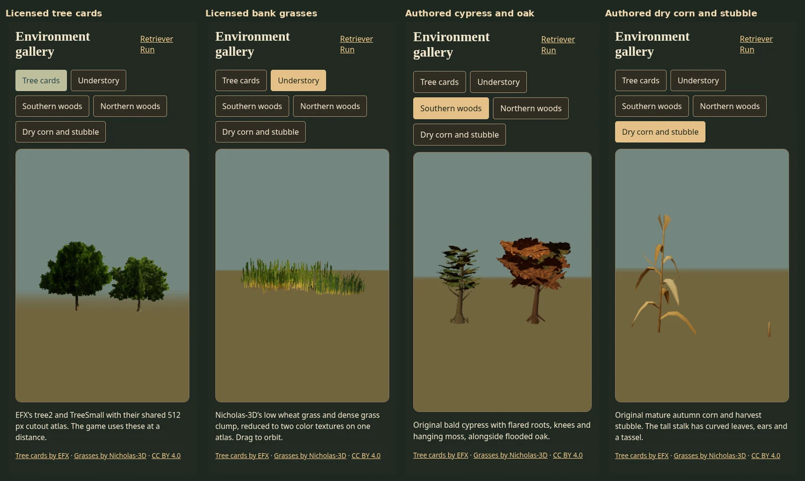
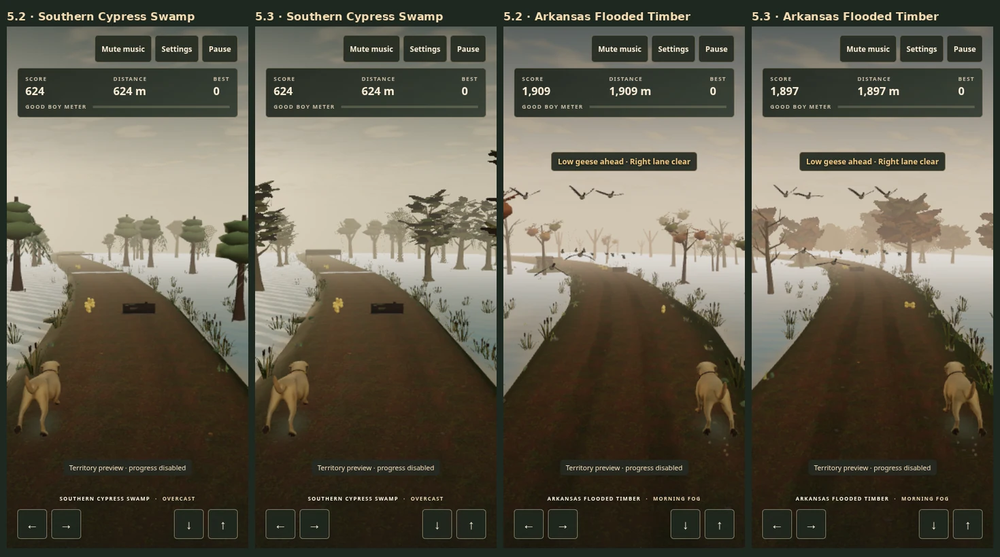
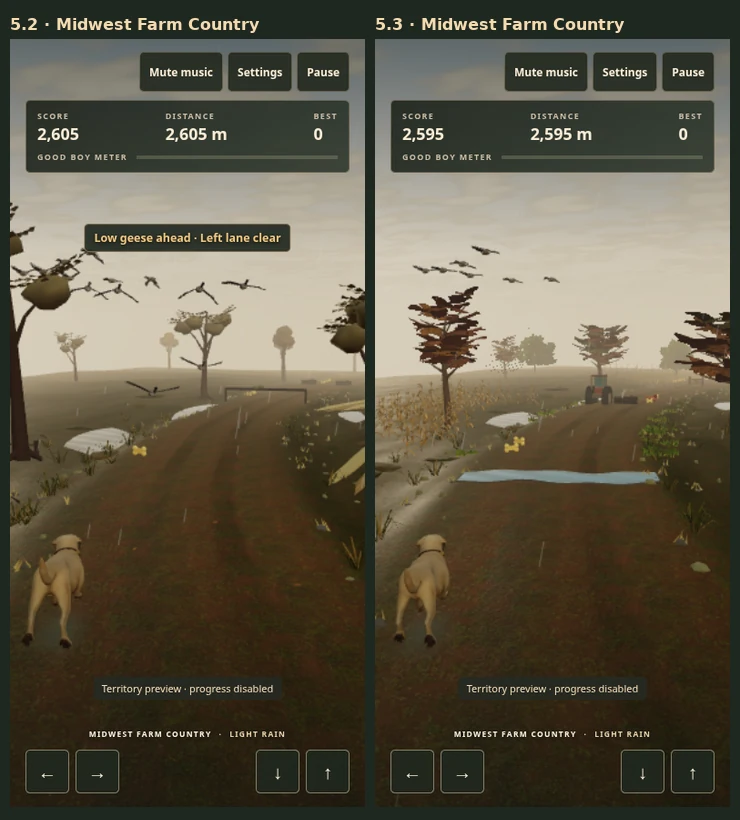
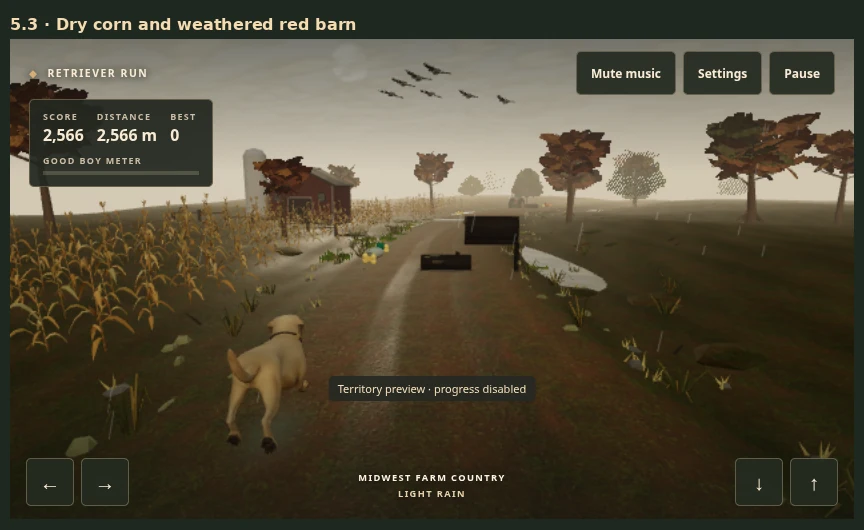
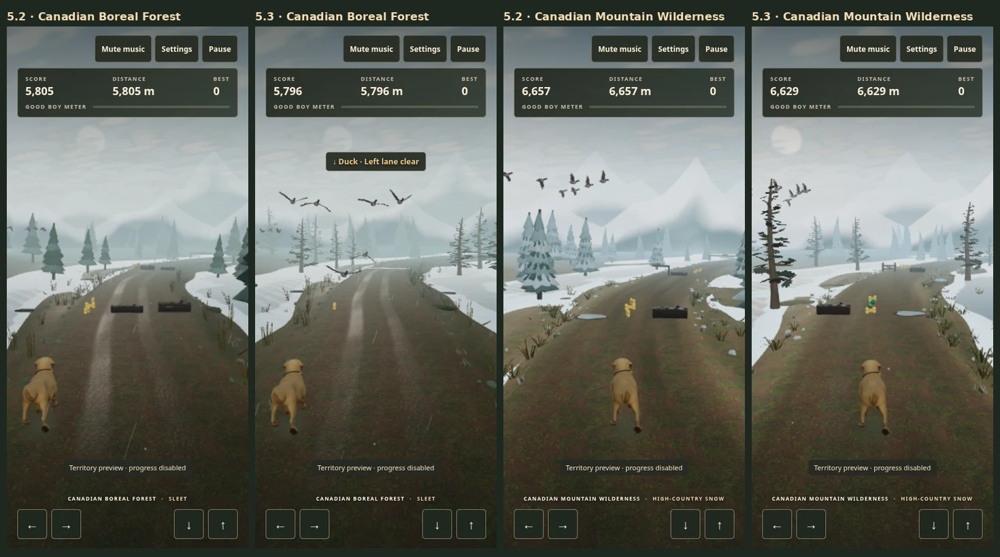
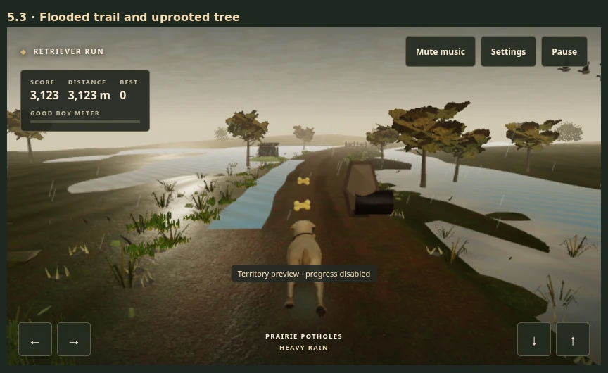

# Retriever Run 5.3 · Premium Environment & Asset Overhaul

5.3 rebuilds all ten territories' tree profiles, adds mature autumn corn and a red Midwest barn, and gives large hazards visibly different avoidance rules. The ten 30-second boundaries, northern endgame, two-layer mountain renderer, Labrador and fitted vests carry forward from 5.2. Changes are scoped to the environment, obstacle design and verification. The Worldwide Camp schema, score envelope, profile identity and Season One records are unchanged.

## Art direction and territory coverage

| Territory | Tree profiles | Environment changes |
| --- | --- | --- |
| Gulf Coast Marsh | Bald cypress and tupelo | Buttressed trees with widely spaced shoreline pockets. Low original wetland detail keeps the silt channel readable. |
| Southern Cypress Swamp | Mature bald cypress | Flared bases, knees, twisting boughs and individual hanging moss strands. |
| Mississippi Flyway | Cottonwood and oak | Varied tall riparian crowns, short licensed grass clumps on banks, distant licensed broadleaf cards. |
| Arkansas Flooded Timber | Mature oak and leafless snags | Broader amber oak crowns, irregular forks, exposed branches and tree-card silhouettes behind flooded timber. |
| Midwest Farm Country | Maple and oak | Mature autumn corn in seven-row strips, harvested stubble, a weathered red barn, white trim, silo and fences. Optional wheatgrass is restricted to the understory. |
| Prairie Potholes | Sparse cottonwood and aspen | Sparse trees in open water, an occasional field-edge crop strip, licensed grass near the trail and original blinds and decoys. |
| Dakota Wetlands | Aspen and birch | Sparse pale stems and fine canopies separated by open sloughs and rush banks. |
| Northern Borderlands | Birch and spruce | Mixed woods frame the original camp, canoes, dock and the beginning of the mountain backdrop. |
| Canadian Boreal Forest | Spruce and fir | Needle sprays follow staggered branches rising up the trunk. Balanced and Battery Saver use a compact mesh. |
| Canadian Mountain Wilderness | Fir and snow-covered pine | Higher snow cover, original alpine needle textures, frost-covered understory, cairns, ice and stable mountain parallax. |

Original 512 px foliage art supplies the close conifer sprays and broadleaf clusters. Instanced geometry supplies separate trunks, roots, forked branches and irregular crown heights. The same tree models carry independently seeded sizes, widths, rotations and palettes. Distant scenery retains the 5.2 fade band and is independent of mountain positioning. Optional tree cards appear in the broadleaf territories after they are ready. Asset completion never moves an already-visible tree.

## Uploaded models and license decisions

The [asset inventory](ASSET-INVENTORY-5.3.md) tracks all 33 owner uploads. It documents the 25 accessible packages, the eight blocked by the transfer size limit, and the rights status of each. Two verified CC BY 4.0 packs are in the game. Their optimized runtime bodies total **120,852 bytes**. The original foliage atlas adds **36,282 bytes**.

| Runtime asset | Payload | Use |
| --- | ---: | --- |
| EFX's selected `tree2` and `TreeSmall` GLB | 3,080 B | Two 12-triangle cutout meshes. Vite inlines the small GLB. |
| EFX foliage atlas | 64,302 B | One 512 × 512 WebP for both cards. |
| Nicholas-3D's selected wheatgrass and grass clump GLB | 10,176 B | Two static plant meshes for dry and wet trailside clusters. |
| Nicholas-3D grass atlas | 43,294 B | One 512 × 512 WebP for both clumps. |
| Original leaf-and-needle atlas | 36,282 B | One 512 × 512 WebP shared across close trees and all territories. |

The EFX GLB is a re-export of the supplied FBX, verified in Blender 4.3 during the earlier asset comparison. It reuses the tested atlas and normalized pivots. The grass selector reads the supplied GLB, copies only the selected position, normal, UV and index accessors, then writes the remapped GLB and atlas. The local gallery and game both load the outputs through Three.js. [Earlier FBX workflow](docs/visual-audit-4.4/MEASUREMENTS.md#supplied-trees-and-bush-pack) · [Grass export script](scripts/prepare-grass-assets.py) · [Original foliage atlas generator](scripts/prepare-foliage-atlas.py)

Both optional packs prefetch before their first territory. Missing files leave the procedural version visible. The offline app shell excludes the optional pack files, so those files cannot block offline installation. Mesh and texture packaging was chosen for these small assets. Additional decoder and texture-transcoder dependencies would add overhead for little transfer gain here. [Attribution and license](src/assets/environment/ATTRIBUTION.md)

## Obstacle rules

| Visible hazard | Safe response |
| --- | --- |
| Small log or narrow creek | Jump at the correct time. Change lanes around small obstacles where a lane is available. |
| Low overhead timber | Slide or choose an open lane. The visible upper branches occupy the jump space. |
| Large uprooted tree or farm tractor | Change lanes. The root plate and tractor cab extend above the normal leap envelope. |
| Flooded lane | Change lanes before the washout and remain in the clear lane until dry trail. The curved water surface follows the lane and is nearly 30 m long. At maximum speed a normal jump covers about 26.4 m. |
| Diving goose | Judge the flight cue and height. Existing flight animation and three-dimensional contact still apply. |

The route planner checks each generated row against its established reaction window, lane response and swept collision geometry. A washout reserves the complete wet segment and recovery before the next decision. Overlapping paw-contact segments follow the surface through bends. A seeded fallen tree can block a second lane and the remaining lane stays usable. Decorative trees, corn, barns, silos and fences stay outside the hazard list and the playable lane envelope. The scoring multiplier and player movement timing carry forward.

## Visual verification

The gallery can be opened locally using `npm run dev` and the `/environment-gallery.html` route. Select a group and drag to orbit. The gallery presents the two original uploads' actual optimized meshes under neutral lighting and shows the authored close trees and corn.

The screenshots use the existing isolated route preview at comparable points in each territory. Hazards, weather, dog animation and the HUD remain active. Comparisons use the same CSS framing where practical. The farm scene uses a wider gameplay view to include the barn and corn.

## Performance and QA

The static production output is about **2.23 MB uncompressed** including the existing audio and backend adapter. The two new optional atlases add about 2.67 MiB of estimated decoded mip storage when loaded. The foliage atlas adds about 1.33 MiB. Those estimates assume RGBA8 and exclude framebuffers and driver overhead. Each vegetation batch reuses one prototype mesh and one material. The seven-slot terrain pool releases old ground, water and detail buffers as it recycles. The reduced conifer mesh keeps the per-instance cost lower on the mobile presets while High keeps the full branches.

| Balanced Linux Chromium scene | Median draws | Median / peak triangles | Peak tracked buffers | Median / p95 wall interval | First ready |
| --- | ---: | ---: | ---: | ---: | ---: |
| Cypress Swamp | 49 | 148,349 / 148,349 | 2.54 MiB | 325 / 1,016 ms | 3.12 s |
| Flooded Timber | 61 | 151,055 / 151,105 | 3.15 MiB | 675 / 1,416 ms | 4.82 s |
| Midwest farmstead | 63 | 139,537 / 139,537 | 3.11 MiB | 767 / 1,450 ms | 2.12 s |
| Boreal Forest | 56.5 | 142,839 / 143,541 | 3.17 MiB | 458 / 1,133 ms | 2.46 s |
| Mountain Wilderness | 62 | 119,397 / 127,681 | 3.06 MiB | 317 / 1,050 ms | 2.81 s |
| Alpine transition | 60 | 127,839 / 136,281 | 3.69 MiB | 775 / 1,583 ms | 2.87 s |

These short probes use a software renderer, iPhone-sized viewports and deterministic visual steps. Wall intervals include software rendering and host contention. Before the compact conifer mesh, the Boreal probe submitted 173,319 peak triangles. The compact preset lowered that to 143,541, about 17%. The 5.2 Flooded Timber peak was 152,827 triangles and 7.89 MiB in the earlier comparable probe. The new version uses more draws in this area and fewer tracked buffer bytes. The final alpine capture showed a maximum single tracked upload of 1.69 MiB. [5.2 baseline](GREAT-MIGRATION-5.2.md#verification-and-performance)

- All **96 automated tests** and the production build passed. Tests cover full-height collisions with large hazards, slide clearance, washout jump timings, tile disposal, cache failure and season compatibility. The production suite has no separate lint command.
- The **10,000-session** stress run covered **31,827,915 simulation ticks** with **6,001 guided sessions**, including 5, 10, 20 and 30 minute routes.
- Both Chromium and Linux WebKit displayed the environment gallery at a 390 px viewport and recovered when the optional atlas was deliberately blocked. Linux WebKit ran the Midwest, Boreal and alpine crossover in the mobile layout.
- A rendered Chromium soak reached **126 seconds** of active play with one WebGL context and seven terrain slots. The two post-collection JavaScript heap readings were **6.82 MiB** after startup and **9.19 MiB** at the end. The latter includes additional streamed resources. These two samples cannot establish a long-run memory plateau.

## Device acceptance and open items

Physical iPhone Safari frame pacing, texture residency, thermal behavior and sustained battery use require measurements on devices. Headless Chromium and Linux WebKit are separate checks. On a current and an older supported iPhone, compare Balanced and Battery Saver through Boreal Forest and its alpine handoff. Play the Midwest at full speed and check the contrast between the corn, a tractor and playable barriers. Test a late washout, including a failed jump and a successful lane change. Leave and resume Safari around a territory boundary, inspect the Field Journal and Kennel, and check that legitimate local saves and Season One rivals still open.

For a later asset pass, smaller licensed source exports would let the eight blocked models be inspected. Obtain evidence of public web and repository redistribution for any proposed new third-party building, tree or scan. The raw beech and poplar models also need substantially smaller LODs before they are candidates for repeated trees. New scenes keep the original authoring style where a cleared uploaded model was unavailable.
