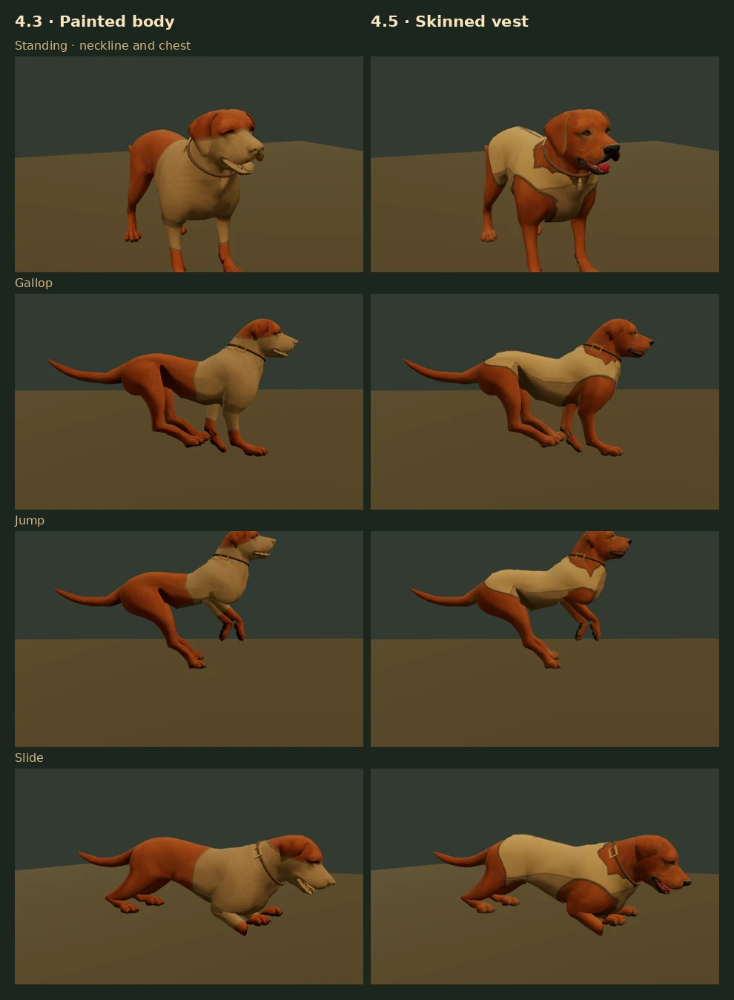
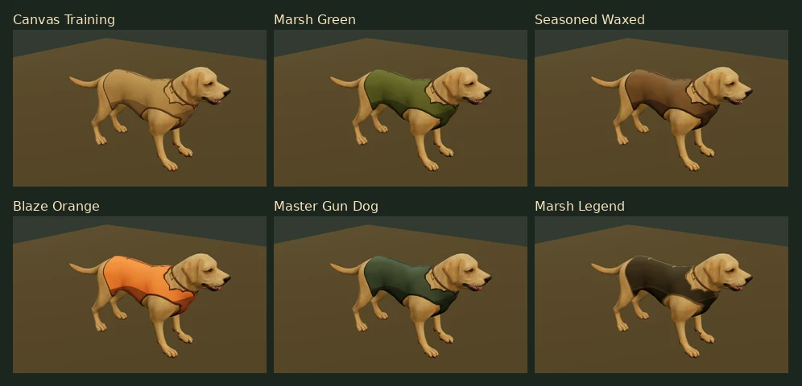
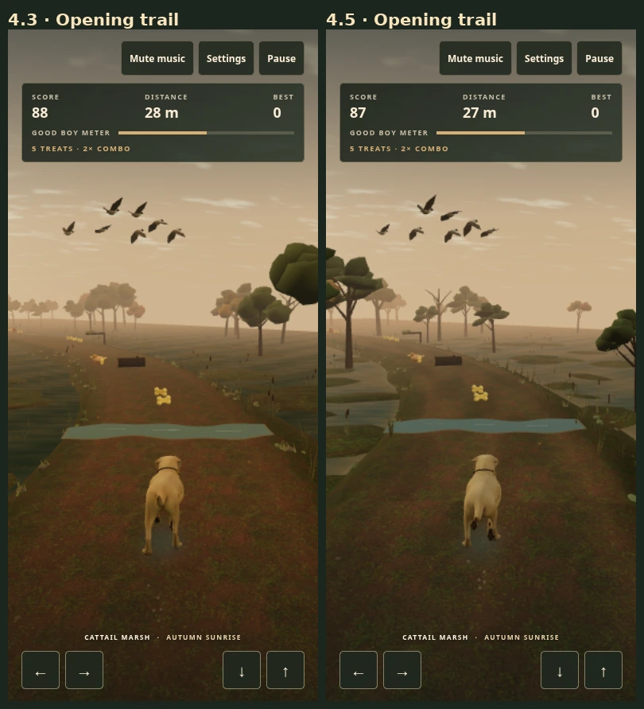
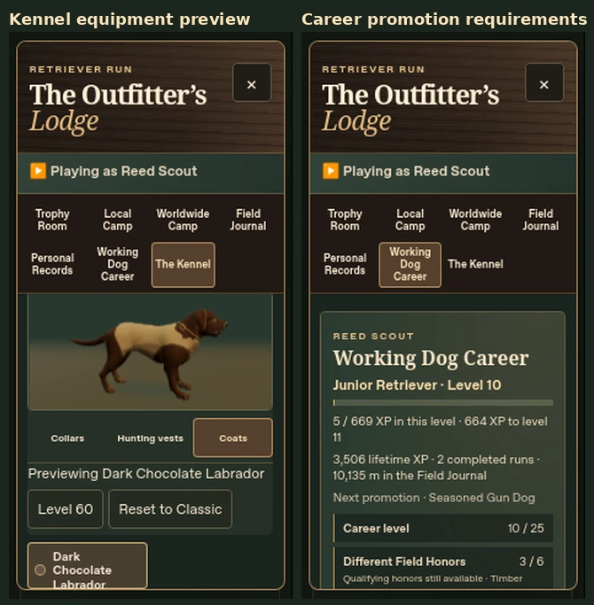

# Retriever Run 4.5 · Operation Sporting Dog

## Release overview

4.5 keeps the original Labrador and gives it a separate skinned hunting vest. The wetlands use more varied foliage silhouettes, a wetter trail edge and shallows that pick up the sky color. Working Dog Career now tracks experience levels independently of major rank. New promotions require both XP and Field Honors. Existing players keep their earned rank, gear and lifetime experience.

The visual work starts from the [4.4 audit](VISUAL-AUDIT-4.4.md) and its [source review](https://github.com/bladunk/Retriever-Run/pull/11). The release also draws on the review of the supplied [FeralMotion Labrador](docs/visual-audit-4.4/MEASUREMENTS.md#supplied-feralmotion-labrador) and [vegetation candidates](docs/visual-audit-4.4/MEASUREMENTS.md#supplied-trees-and-bush-pack). The shipped Labrador and existing texture files remain the only production character and terrain asset downloads. All new garment and vegetation geometry is generated by the game. External asset spend was **$0**.

## Labrador and vest

The game loads the same 292,936-byte GLB with 9,967 triangles and 54 joints. The coat now has fine, distance-faded shading and a softer, more natural sheen. Dark albedo regions such as the nose and eyes retain their original color through coat changes. Hang of the ears, paw anatomy and facial expression remain limited by the original mesh and clips. The shared model and renderer keep the Kennel preview consistent with gameplay.

The vest is patterned on the actual mesh in anatomical bind space. It has a shaped dorsal panel, chest and underside coverage, a curved neckline, open front legs, bound hems with physical thickness, stitched panel lines and a dorsal closure with keepers. The [waterfowl vest reference](https://rigemright.com/products/bloodline-elite-dog-vest-optifade-marsh) informed the cut. The design and shader geometry are original.

The generator cuts the body triangles at the pattern edge, blends and normalizes up to four joint influences at each cut, raises the shell above the fur and connects the hem to an inner rim. The 1,991-triangle garment uses the existing skeleton and animation mixer. All six styles share its 1,211 vertices, approximately 87 KiB of vertex and index data, and one material. Their canvas, marsh green, waxed, blaze orange, master and legend colors have distinct bindings, panel colors and roughness. An equipped vest adds one draw, zero textures and zero model requests. Selecting No Vest removes the draw. The procedural fallback shows the selected collar and coat if the GLB fails to load.

The run, jump, slide and idle clips, neck-bone collar, paw support and collision solver are preserved. The garment follows rapid pose transitions. Some jaggedness at the neckline in a close side view comes from the cut traversing the stock body topology. A future custom mesh could smooth that detail and preserve more cloth volume during extreme torso bends. The restraint at the hem has no simulated cloth motion, hanging pull or separate buckle mesh.

## Wetlands and Lodge

- The ground reuses an indexed grid and keeps the original trail heights and section seams. Broad silt variation breaks up repeated mud texture, the bank blends into wet soil, and the lighting keeps trail obstacles readable.
- Low-profile willow crowns, angular leaf tips, slimmer branching and pointed reed blades vary the silhouette. Nearby tile scenery is batched. Distant trees use shared 90-triangle live or 30-triangle flooded-timber silhouettes and per-tile instancing. Low transitions to distant scenery sooner. Reeds keep the existing three density tiers.
- Shallow water uses a bank-depth attribute with a colored sediment band, layered ripples and a sky-colored grazing highlight. It takes a single surface draw per water-bearing tile. The golden-hour key, cool sky fill and fog improve separation. Tree distance transitions can still be visible under a clear sky.
- The Kennel holds the larger, more side-on dog preview and its controls visible while the equipment list scrolls. It distinguishes equipped, available and previewable locked items and gives the exact lock condition. The Career screen shows independent level and rank, current XP, progress on each promotion requirement, missing honors and which Kennel rewards are available. Both retain the walnut, green, cream and brass palette.

## Working Dog Career

| Major rank | Level | Lifetime XP | Field requirements for new promotions |
| --- | ---: | ---: | --- |
| Pup | 1 | 0 | Starting rank |
| Junior Retriever | 10 | 3,501 | Three different Field Honors |
| Seasoned Gun Dog | 25 | 19,416 | Six different Field Honors including Clean Paws, which requires surviving two minutes on one run |
| Master Retriever | 50 | 73,941 | All eight different Field Honors, two of those at Silver or higher, including one obstacle honor at Silver or higher |
| Marsh Legend | 100 | 287,991 | All eight different Field Honors, three Silver or higher, two Gold obstacle honors, Gold Marsh Legend for covering 200 km, one five-minute run, and 100 lifetime duck or pheasant retrieves |

Timber Jumper, Low Rider and Goose Whisperer are the qualifying obstacle honors. The existing catalog has eight distinct Field Honors. Master uses all eight plus two advanced tiers to reach ten earned milestones. The distinct Field Honors and their goal thresholds are unchanged. Hall of Shame and Worldwide leaderboard results do not qualify. XP continues to accumulate when a requirement blocks a rank. The next eligible completed run grants any qualifying promotions in order, and ceremonies stay queued until acknowledged.

Level 2 keeps its 110 XP threshold so early 4.3 profiles retain their first milestone. Levels 3 and later use `n = level − 1` and `XP = n × (165 + 28 × (n − 1))`. 4.3 granted Junior, Seasoned, Master and Legend at 1,070, 4,752, 12,080 and 25,920 XP, respectively. Promotion awards now gate Junior Field Collar, Seasoned Waxed Vest, the Master collars and vest, and Marsh Legend Vest. Classic gear remains available immediately, Forest Green Collar at level 3, Canvas Training Vest at level 5, Blaze Collar at level 7 and Light Cream Labrador at level 8.

| Legitimate run event | 4.3 XP | 4.5 XP |
| --- | ---: | ---: |
| Completed run of at least two seconds | 25 | 15 |
| Each full 100 m | 10 | 8 |
| Verified jump or slide clearance | 5 | 5 |
| Verified goose dodge | 15 | 15 |
| Treat | 2 | 1 |
| Mallard or pheasant retrieve | 20 | 18 |
| Score or distance personal best, once per run | 75 | 50 |
| First award of a Field Honor | 50 | 45 |

The same swept clearance and pickup logic supplies those counters. Repeated button presses, uncompleted runs, diagnostic runs, previously finished run IDs and higher patch tiers generate no event XP.

### Progression estimate

`npm run stress -- 500 0 career` replayed 500 deterministic routes from seed 0. The XP estimate uses measured in-game duration and scored events, then adds four seconds for each restart. It omits first-honor and personal-best bonuses because those are finite. The guided cohorts read obstacle cues from the course generator. They estimate practiced play under a controlled policy. Exploratory runs use random or no input and represent repeated early failures.

| Cohort | Runs | Mean time / distance | Mean repeatable XP | Level 10 | Level 25 | Level 50 | Level 100 |
| --- | ---: | --- | ---: | ---: | ---: | ---: | ---: |
| Exploratory | 199 | 4.0 s / 46 m | 20.6 | 0.4 h | 2.1 h | 7.9 h | 30.9 h |
| Guided | 297 | 40.9 s / 655 m | 199.2 | 0.2 h | 1.2 h | 4.6 h | 18.0 h |

These are level estimates. Honor requirements can prolong access to a rank even after its level threshold. In the four additional endurance routes, the 300-second run scored 55,954 points and retrieved 15 birds, and the 1,800-second run retrieved 72 birds with 46 verified goose dodges. This exercised the existing score and survival targets and confirmed that the retrieve and obstacle tallies grow through normal play. Human completion times will vary with skill and run length.

### Save migration

The local Lodge save advances from schema 2 to schema 3. The migration copies the XP balance, computes the previous level with the 4.3 curve, preserves the highest rank earned under that curve and carries across eligible pending ceremonies. All cosmetics available at the former level become inherited entitlements, including choices never equipped. An equipped item keeps its existing ID. The new level is recalculated from unchanged lifetime XP, so a returning player can show a lower numerical level and retain their former rank. The Career screen displays the previous level and rank and explains that carryover. For example, someone who earned Marsh Legend and Chocolate at old level 35 with 32,912 XP enters 4.5 at level 32 with both intact.

Local player IDs, nicknames, enrollment, records, runs, patch dates, and local leaderboard entries stay in the same save. Score receipts, authentication and Worldwide Camp records remain in their existing storage and service. A completed run commits the updated XP, record and pending ceremony together with the run ID high-water mark. The migration generates no award transaction for previously earned XP, rank or gear. Legacy pre-4.3 save handling also remains available.

## Rendering measurements

Matched 4.3 and 4.5 production builds ran seed 7 from loopback in Linux Chromium with ANGLE SwiftShader. Both used a 390 × 844 CSS portrait viewport and a 292 × 633 draw buffer. Each warm opening sample contains nine presented frames between about 0.8 and 2.7 seconds of game time. The opening samples have the classic outfit so they isolate the scenery work. The 4.4 audit’s 240k–246k opening baseline and its 278,972-triangle guided-route peak are separate runs under the original audit conditions. [4.4 measurement notes](docs/visual-audit-4.4/MEASUREMENTS.md)

| Opening, median unless specified | 4.3 Low | 4.5 Low | 4.3 Balanced | 4.5 Balanced |
| --- | ---: | ---: | ---: | ---: |
| Draw calls | 47 | 55 | 48 | 55 |
| Submitted triangles | 239,580 | 109,720 | 243,624 | 127,834 |
| Tracked WebGL vertex/index buffers | 18.95 MiB | 5.32 MiB | 18.95 MiB | 6.62 MiB |
| CPU frame callback, median / p95 | 6.7 / 13.5 ms | 6.0 / 10.3 ms | 2.4 / 35.8 ms | 7.8 / 15.7 ms |
| Browser callback interval, median / p95 | 1,017 / 1,333 ms | 583 / 833 ms | 950 / 1,183 ms | 1,150 / 2,700 ms |
| First ready trail and skinned draw | 10.31 s | 4.77 s | 4.51 s | 6.22 s |

Low submitted **54% fewer triangles** and Balanced **48% fewer**. The extra draws are the tradeoff for separating near scenery, distant trees and the indexed ground. The opening met the audit's triangle budgets. The Low opening exceeded the audit's typical 50-draw target and stayed below its 60-draw peak target. Buffer observations are driver-facing allocation requests, separate from framebuffer memory and the **6.37 MiB** art-texture estimate, which is unchanged. Visual binary payloads remain **483,300 bytes**. The uncompressed build grew by about 12 kB from the 4.3 reference.

The software renderer and concurrent load on this host produced variable callback intervals and startup times. These samples measure rendering work and resource pressure. Physical Safari startup, thermal behavior, GPU frame time and battery impact remain unmeasured. An isolated Node run of 3,000 CPU pose calls per state observed median costs of 0.071 ms idle, 0.077 ms gallop, 0.081 ms jump and 0.137 ms slide. The 4.4 audit's respective medians were 0.071, 0.067, 0.071 and 0.125 ms. Node excludes GPU skinning.

Auto retains its adaptive resolution and density tiers. If it remains slow after reaching Low, it can reduce presentation to a 30 Hz target. The 120 Hz fixed-step clock, input and collision work run independently of that cap. A unit test checks a synthetic slow-to-fast cadence and manual-preset recovery.

## Verification

- `npm test` passed **82 tests**. Coverage includes all rank thresholds, honor gating, multiple queued promotions, replay and reload protection, 4.2 and 4.3 saves, all six garments, and fitted idle, gallop, jump and slide envelopes against the original collisions. Terrain tests cover tile replacement and vertex-by-vertex seams.
- `npm run stress` passed **10,000 seeded sessions** and **31,804,151 fixed steps**. The longest simulated run lasted 1,800 game seconds. `npm run stress -- 500 0 career` exercised the progression estimate.
- `npm run build` produced the production Vite build. The unchanged Pages workflow publishes only from `main`. The PR build is suitable for a local Safari test without any database migration.
- `npm run test:browser -- slow` passed in Chromium at 390 × 844 with trusted CDP touch, a throttled loopback connection, pause/resume, WebGL context recovery, Field Report, audio and reload. `npm run test:browser -- webkit` passed at the same CSS size in Linux WebKit with trusted pointer drags.
- `npm run test:top-dog` passed in desktop Chromium and Linux WebKit at 390 × 844. The WebKit 320 × 640 run also passed. The fixture covers real local run completion, a post-run promotion, equipped gear and reload, locked preview, Guest-to-Worldwide enrollment, a rival comparison and cached offline play. Worldwide Auth and RPCs used an isolated HTTPS fixture. All score submissions stayed on loopback.

## Asset recommendations

| Priority | Recommendation | Integration criteria |
| --- | --- | --- |
| Labrador | **Keep** the shipped GLB and fitting. | Reconsider only if an artist can provide a scale-matched 10k–12k-triangle GLB with comparable paw positions, short-fur material, coat masks, and credible gallop, idle, jump and slide on a retargetable rig. Require a vest and collar fitting test with collision envelopes before licensing. The supplied FeralMotion rig remains a candidate for a separate retargeting study. |
| Vegetation | **Improve with code** in this release. Conditional **$15–35** for distinctive near-bank wetland detail later. | Prioritize willow, buttonbush, reed and cattail silhouettes. Aim for ≤1,200 triangles for a near hero tree and ≤100 for a distant tree, with a shared ≤512 px atlas. Require cheap alpha cutouts or solid meshes and test across fog and silhouette transitions. The two supplied CC BY broadleaf trees remain optional distant assets and would require attribution and license links. |
| Wildlife | **Defer** a conditional **$15–45** purchase for a single hero waterfowl asset. | Require a 1,500–3,000-triangle GLB, a shared ≤512 px material set, flock instancing compatibility, usable bank, glide and dive motion, and stable placement against the existing gameplay cues. Test it in motion at the actual gameplay camera size. |
| Obstacles | **Keep** existing models and their tested placement. | Consider material or bark silhouette detail only if it stays aligned with the existing collision volume. |

For any later purchase, confirm that the license explicitly permits web-game distribution and modification, including client-downloadable or public-repository builds where applicable. Preserve author attribution and redistribution terms. The optional vegetation and waterfowl spending ceiling remains **$80**.

## Physical iPhone acceptance checklist

1. Open the PR build in Safari on a recent and an older supported iPhone. Use portrait, check the top and bottom safe areas and verify Start, touch swipes, tap controls, pause and resume.
2. Check a standing, galloping, jumping and sliding dog in two strongly contrasting vests. Inspect the neckline, chest, front leg openings and underside. Confirm that adding a vest leaves coat, paws, ears and collar intact.
3. Run through marsh, flooded timber, woodland and fog. Look for a visible bank seam, a tree transition or a glint that makes a hazard harder to read.
4. Use the Safari Web Inspector frame timeline. Warm the game first and record 60 seconds of presentation data at Auto, then Low. Aim for a recent-iPhone 60 FPS presentation and an older-phone 30 FPS fallback with consistent touch response. Note device, iOS version, power state, median and p95. Recheck after five minutes for thermal degradation.
5. Browse the Kennel and Career on a narrow portrait screen, preview and equip an available garment, then reload. On a copied save near a promotion, finish the run, acknowledge the ceremony, and reload again. Check inherited gear and pending score receipts offline using a dedicated fixture or test profile.
