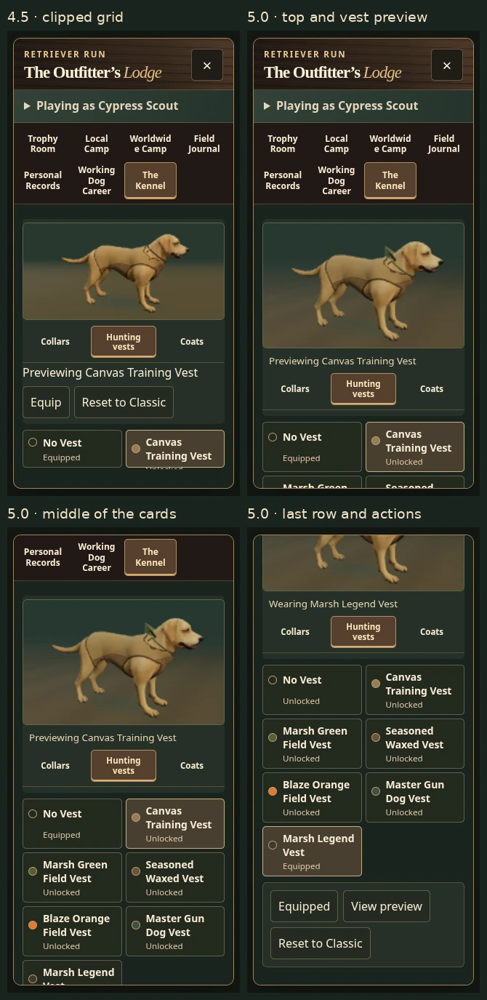
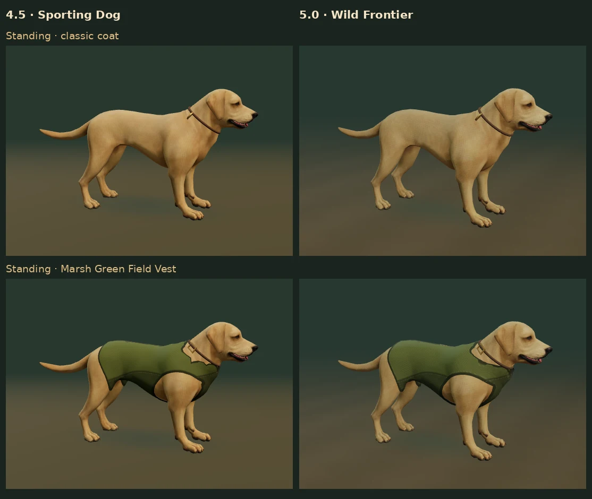
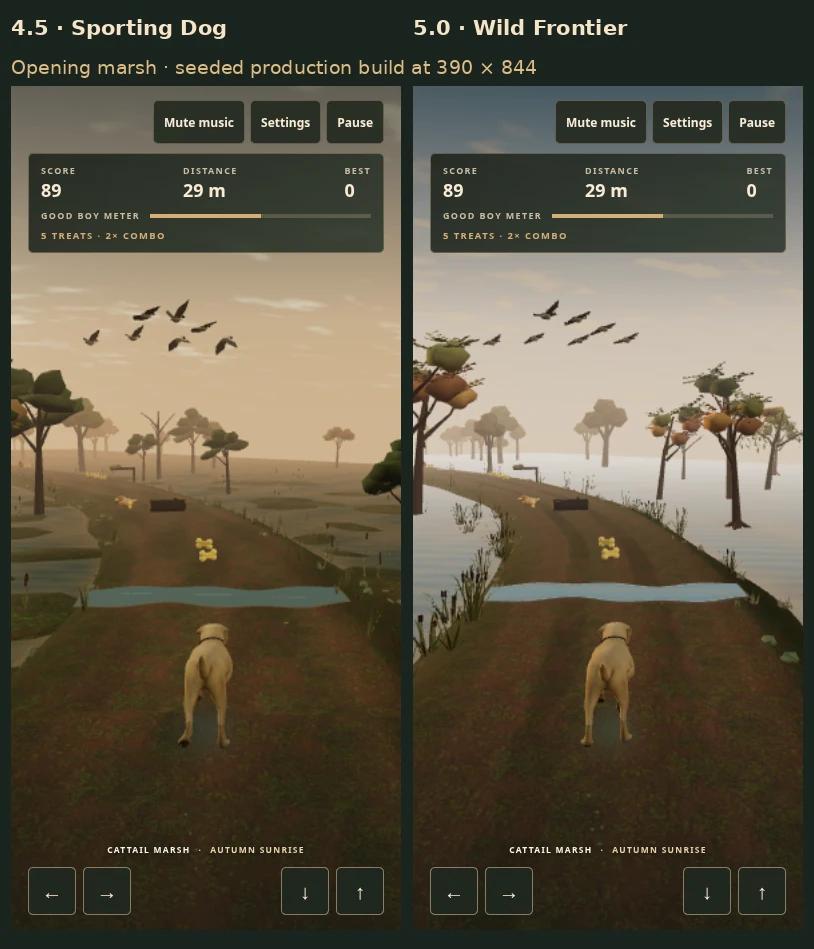
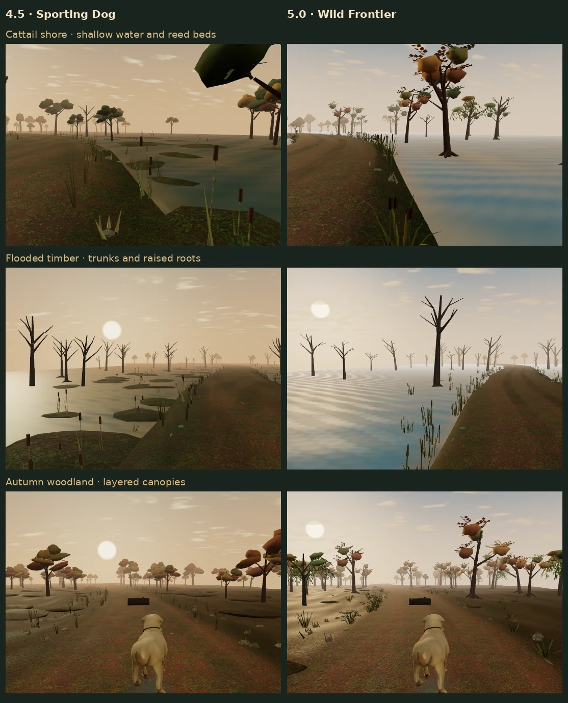
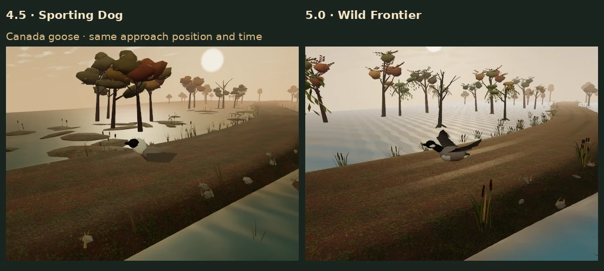

# Retriever Run 5.0 · Operation Wild Frontier

## Executive summary

5.0 repairs narrow-screen Kennel scrolling and rebuilds the marsh presentation around layered wetland plants, branching trees, shallow water and morning light. The original Labrador now has region-specific fur and wet-surface shading, secondary ear and tail movement, and better defined fitted vests. Waterfowl use articulated feathered wings with species-specific silhouettes. Existing routes, collision volumes, scoring, progression, saves, cosmetics, Worldwide Camp and audio retain their established behavior. Production art uses the shipped files and new procedural geometry. New asset spend was **$0**.

The comparison starts from merged 4.5 at `a3c2075`. The [4.4 audit](VISUAL-AUDIT-4.4.md) identified the original draw and triangle costs and the limits of the dog rig. The [4.5 report](SPORTING-DOG-4.5.md) records the separate vest geometry, indexed terrain, art residency, and the first near/far scenery split. 5.0 keeps the single WebGL 2 renderer, shared game and Kennel dog, seven-slot terrain worker and deterministic route. The isolated local baseline was built directly from that merged revision.

## Kennel scrolling

At 320 × 640, Chromium measured **54 px of scrollport for 233 px of vest cards** in 4.5. A constrained flex dialog held an `overflow: hidden` tab panel, a nonshrinking preview, category and action block, and a separate scrolling grid. The dialog itself had no scroll range. A scrollbar or touch target could therefore be confined to roughly one equipment card. Viewport and toolbar height changes made the available nested scroll area unpredictable.

The Lodge dialog is now the sole scroll container. The preview, filters, card grid and actions are in normal document order. **View preview** returns to the 3D view from the action block after a long list. Cards retain their DOM nodes and focus when the player changes a selection. The dialog uses dynamic viewport height, safe-area margins and padding, and the Visual Viewport API when available. A stage resize observer updates the actual canvas independently of the window. The same touch pan works when it starts over the preview, with gameplay touch handling restored after the Lodge closes.

The automated test uses the production build, existing profile schema and local storage. An isolated progressed player begins with the inherited Marsh Bandana. The matrix tests all three categories, selects and equips their first or last items, changes categories after scrolling, resets, reopens and reloads the Lodge, and starts a run afterward. It also tests a 463-pixel-high resized viewport with the nickname field focused. Chromium uses native CDP touch gestures. Playwright WebKit in mobile mode uses keyboard scrolling for the explicit scroll gesture and touch taps for the cards. Physical iPhone toolbar, software keyboard and touch inertia remain device checks.

## Labrador and fitted gear

- The original 9,967-triangle, 54-joint Labrador, its four authored clips and its embedded 768px coat texture are retained. Bind-space shading differentiates warmer cheeks, darker folded ears and back, a softer muzzle transition, paw fur and dark pads. Fine directional fur grain fades with distance. The dark nose and eyes pick up smaller gloss highlights while the coat stays matte. The existing albedo and UVs supply face markings.
- Ear joints and the tail have restrained secondary motion driven by stride, slide, airborne and landing visual state. These offsets layer on top of the original clips, then restore the underlying bone poses before the next blend. The original paw support and course collision are preserved. The supported gait, jump anticipation, foot placement and face anatomy are limited by the authored rig and clips.
- The fitted shell still shares the Labrador skeleton. Its cut now solves the curved pattern along the existing triangle edges. Thicker rolled binding and localized chest loft give the garment more structure. Panel seams, bound stitches, closure teeth, dark rails and brass-colored hardware are rendered in the existing cloth draw. Canvas, waxed and neoprene-style materials use the existing appearance styles with different weave and roughness. The garment lies outside the fur and leaves the face, uncovered legs, paws and tail free.
- The Kennel uses a softer directional key and rim, shadowed floor and closer framing. It still shares the production rig and renderer, with one original GLB request. No cloth simulation, strand fur, new texture or extra vest draw was added.

## Marsh, water, lighting and wildlife

| Area | 5.0 changes |
| --- | --- |
| Trees | Tapered and bent trunks, exposed roots and finer branch forks. Broadleaf trees and drooping willow crowns use clusters of folded leaves around smaller internal crown forms. The existing instanced distant silhouettes retain their low geometry cost. |
| Bank vegetation | Three original plants use curved, folded blades, banded seed heads and habitat-specific shapes. Cattails, rushes and sedges occur in seeded shoreline pockets. Mobile quality tiers use simpler meshes at distance, while the GPU handles wind from each clump’s root. Instance matrices upload when a tile is loaded. |
| Terrain | The near bank has shallower channels, sediment patches, washed sticks and root shade. Ground coloration varies with ruts and wet shoulders. Indexed terrain, tile seam locations, lane widths and the playable center height are retained. |
| Water | A shared opaque water shader renders the marsh plane, puddles and streams. Mud and depth gradients, shore darkening, a thin wet band, terrain-anchored waves and a directional sky reflection supply depth and movement. Crossings carry a more visible cool tint. Balanced and High add filtered fine ripples. |
| Lighting | A cooler sky ceiling and warm sunrise horizon share their light direction with the water highlights. Daybreak coloring and soft atmospheric falloff separate the treeline. Baked root and canopy shade and the dog’s two-lobe contact shadow avoid a scene-wide shadow pass. |
| Wildlife and hazards | Canada geese have dark tapered necks and white cheek patches, mallards have distinct crowns and neck bands, and feather panels articulate in two sections. Each flock uses three shared instanced draws. Logs retain their tested silhouette with irregular bark, moss and end-grain rings. Water hazards retain their original physics and warning cues. |

## Graphics quality and performance

Battery Saver retains the previous saved `low` key. It bounds DPR and pixel count, uses simpler atmospheric detail, shorter scenery range and fewer or simpler plants, and uses a 30 Hz presentation target during gameplay. Balanced and High use progressively more geometry and weather detail. Adaptive still chooses tiers from sustained measured frame cadence with hysteresis and can fall back to 30 Hz rendering. The simulation and inputs continue at the existing fixed step independently of presentation. Graphics presets do not alter generation, collisions, scoring or rewards.

Both static builds used seed 7, desktop Chromium with ANGLE SwiftShader, a 390 × 844 CSS portrait viewport and a matched 292 × 633 draw buffer. The sample starts near 0.8 seconds of gameplay and freezes near 2.5 seconds to capture the frame. The table reports 12–19 presented frames per preset and the first draw of the skinned Labrador with the spawn seam ready. The gameplay comparison frame is from this sample.

| Opening scene | 4.5 Low | 5.0 Battery Saver | 4.5 Balanced | 5.0 Balanced |
| --- | ---: | ---: | ---: | ---: |
| Median draw calls | 56 | 45 | 55 | 49 |
| Median submitted triangles | 110,620 | 105,089 | 127,934 | 138,577 |
| Median tracked vertex/index buffers | 5.41 MiB | 5.50 MiB | 6.72 MiB | 6.95 MiB |
| Median / p95 CPU frame callback | 4.3 / 6.0 ms | 2.4 / 10.1 ms | 5.1 / 28.9 ms | 3.6 / 7.8 ms |
| Median / p95 browser frame interval | 383 / 850 ms | 600 / 1,267 ms | 567 / 1,033 ms | 800 / 1,700 ms |
| First ready trail with skinned Labrador | 2.95 s | 4.39 s | 5.51 s | 7.23 s |

Battery Saver cut about **20% of draws and 5% of triangles** in the opening. Balanced cut **11% of draws** while submitting **8% more triangles** for the revised silhouette detail. Software frame intervals and cold startup were longer in the 5.0 captures, which ran with variable load on the host. The small samples and software renderer are useful for comparing submission budgets. They do not establish physical-phone throughput or the cause of the startup difference.

The controlled woodland view at 620 m and 540 × 396 draws **20 / 24 / 28** times on Battery Saver, Balanced, and High, with **117,393 / 155,055 / 166,127** submitted triangles. The matched 4.5 view used 29 draws in all three tiers and 111,316 / 133,600 / 136,084 triangles. The controlled 5.0 flooded timber view stayed at **85,889 triangles and 27 draws** on Balanced. These captures omit the gameplay HUD and ambient birds and are separate from the opening trace. The forest screenshot uses Balanced. Compared with the 4.4 audit's 4.3 baseline of approximately **240k–246k opening triangles and 18.95 MiB** of vertex and index buffers, the updated course still uses fewer submissions and much less geometry residency. [4.3–4.4 measurements](docs/visual-audit-4.4/MEASUREMENTS.md)

Geometry buffer figures record tracked WebGL allocations and exclude the framebuffer, textures and driver overhead. The art texture estimate remains **6.37 MiB** with decoded mipmaps, and visual binary downloads remain **483,300 bytes**. The unchanged compressed Labrador accounts for **292,936 bytes**. The entire static build grew from **2,010,196 to 2,024,114 bytes** uncompressed. Reused plant geometry, packed tile attributes and atlas-free cloth and water shaders keep the additional download limited to code.

## Verification

- `npm test` passed **84 tests**, covering the shipped skin and all six fitted vests, actual grounded and overhead clearances, deterministic habitat regeneration, the three graphics tiers and presentation cadence, collision attribution, save migration and Worldwide rules.
- `npm run stress` passed **10,000 seeded sessions** and **31,804,151 fixed steps**. The collision and gameplay modules are unchanged.
- `npm run build` produced the production Vite assets used in the browser checks. `npm run test:frontier` and `npm run test:frontier -- webkit` covered all five requested viewports using real card activation, equip, switching categories, reset, modal reopening, resizing and local persistence.
- `npm run test:browser -- slow` passed in Chromium and `npm run test:browser -- webkit` passed in Linux WebKit. The suite covers pause and input, audio, replay and the local Field Report. Chromium also exercised WebGL context loss and restoration.
- `npm run test:top-dog` and its WebKit variant use a local HTTPS Worldwide Camp fixture. The test covers anonymous identities, rival overtaking, a career promotion, preview and equip, saved gear, and offline reload. No synthetic scores were written to live Supabase.

## Remaining art work and shopping priorities

All format and budget targets below refer to the deployed runtime export. Suggested amounts are planning caps in USD, subject to authoring scope and a working sample. No purchase has been made.

| Priority | Gap | Requirements | Difficulty and expected visual benefit | Suggested cap |
| --- | --- | --- | --- | ---: |
| 1. Rigged Labrador | Original silhouette, paw shapes, muzzle topology and eyelids limit further improvement from shaders. | GLB 2.0 with Meshopt, 10k–15k triangles, at most two material slots, and one shared map set up to 1K. Request layered coat masks, believable paw pads and eyes, in-place gallop, idle, jump and low slide, plus a documented retarget map for head, jaw, ears, tail and paw IK. Match current scale, leg reach, rest orientation and slide envelope on the playable camera. | High. Strongest close-up improvement if the jaw, ears and foot contacts hold in animation. Require a real clip and collision-alignment proof before buying. | $300 for a compatible library candidate. Quote bespoke work separately. |
| 2. Working vests | The current mesh follows the textured dog surface closely. Real panel volume, dart seams and nonpainted hardware are limited at studio distance. | Skinned GLB shell, ≤3k triangles, one 512px shared cloth and trim atlas, UV seam layout, chest relief, material-bound edges and gear-compatible bone weights across all four poses. Require a fit sample on the actual dog or matching skeleton before purchase. | Medium to high. Improves silhouette and read of closure hardware between styles. | $150 for a fitted prototype |
| 3. Regional wetland plants | Leaf sprays still look faceted close to the camera. Repeated distant crowns show their procedural origin. | GLB willow, alder or tupelo, cattail and rush modules. One ≤512px shared color atlas, opaque silhouettes or tightly trimmed alpha tests. Up to 1,250 triangles for a near tree, ≤100 far, and 35–150 triangles for an instanced tuft. Preserve pivots and use cheap wind masks. | Medium. Most value in the first 30 m and near vegetation against the water silhouette. | $60 |
| 4. Canada goose and mallard | Original procedural feather articulation reads in flight, but detailed head, feet and feather anatomy are limited in close views. | 1,200–2,500-triangle GLBs, one ≤512px atlas per shared flock set, documented in-place flight bank, glide and dive, nested wing and tip pivots. Match cue silhouettes, approach pose and original collision volume. | Medium to high. Strongest during goose approach and Kennel-style close-up studies. | $90 |
| 5. Marsh props | Log caps, decoys and blinds can still read as procedural at the shoreline. | ≤800 triangles per visible prop and shared ≤512px wood or marsh atlas. Require clear LODs and pivots. Any gameplay prop should replace the visible model within the existing collision profile. | Low to medium. Target occasional background landmarks or bark shape first. | $45 |

Confirm web-game redistribution and modification rights, including direct browser download and the public repository when applicable. Keep the license, author attribution and a list of edits in the repository. A marketplace render is insufficient evidence for retargeting, LOD or redistribution. The previously supplied FeralMotion rig still has the measured retargeting, slide and payload gaps described in the [4.4 asset review](docs/visual-audit-4.4/MEASUREMENTS.md#supplied-feralmotion-labrador).

## Physical iPhone Safari acceptance

1. Serve the production build on a private test host or local network. Open it in portrait on a recent iPhone and an older supported phone. Record model, iOS version and power mode.
2. Open the Lodge at the smallest available viewport with the browser toolbar visible. Preview Canvas Training, drag from the model and from a card to scroll, then select the final vest. Use View Preview, switch categories, equip an unlocked item and reopen. Verify Reset and scroll reach after opening and dismissing the nickname keyboard.
3. Run through cattails, flooded timber and autumn woodland. Check water obstacle edges, goose cue readability, pause/resume, and a jump or slide while wearing two contrasting vests.
4. Warm up on Adaptive, Balanced and Battery Saver. Record median and p95 presented intervals over one minute, then repeat after five minutes to assess heat and frame pacing. Test touch response while the rendering tier changes. Check reduced motion, screen rotation and resuming after backgrounding.
5. With a copied player profile, verify equipped and locked items, award history, unchanged local records and cached offline play. Use a disposable test service or fixture for Worldwide receipt testing.

## Deployment and caveats

Node 22.12 or later is supported. Run `npm ci`, `npm test` and `npm run build` to produce the static `dist/` directory. The existing GitHub Pages workflow builds PRs and deploys only from `main`. There is no schema or configuration migration for Worldwide Camp and no secret is required for local graphics review. PR testing uses only isolated services.

The original mesh still limits sculpted anatomy, facial motion and the smoothness of a fitted hem in close extreme bends. Water reflects an analytic sky and sunlight rather than individual trees and reeds. Distant scenery swaps can still be noticeable in clear conditions. All performance numbers in this report use desktop browsers with a software GPU. Physical Safari startup, frame pacing, temperature and battery draw remain unmeasured.
