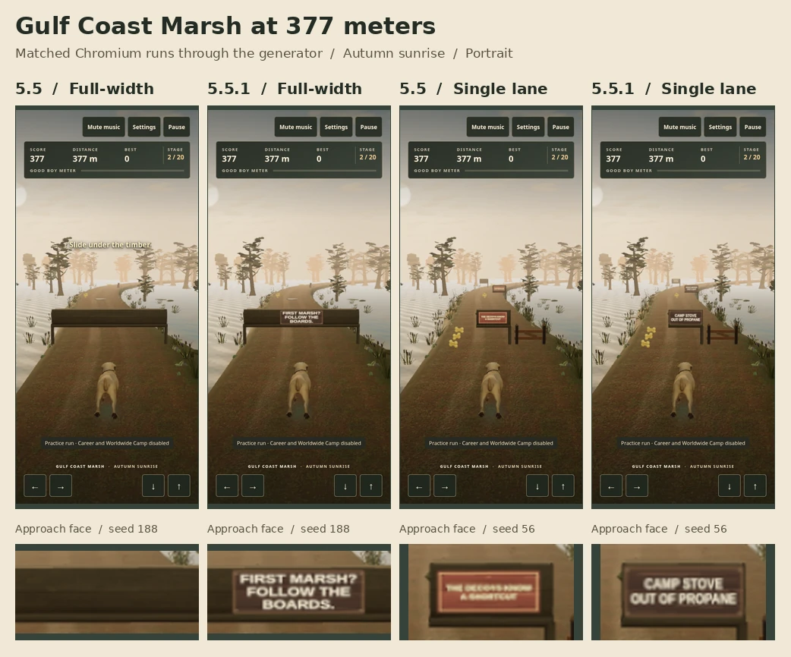

# Retriever Run 5.5.1 · Obstacle sign lettering

## Gulf Coast Marsh at 377 m

The original screenshot was unavailable in the workspace. The comparison reconstructs the reported territory and distance through two seeded runs of the production game. Both releases were captured at 377.26 m using the same seed and graphics preset for each pair. Seed 188 puts a full-width timber at 386.37 m. Seed 56 puts a single-lane timber at 386.23 m.



## Why the boards were blank

The procedural generator uses the `branch` hazard for the wooden timbers in playable lanes. The 5.5 renderer skipped every full-width `branch` and could attach only two lettering planes to single-lane branches in its distance window. That left some qualifying single-lane boards blank as well. The ordinary fence is a separate hazard with two posts and rails.

The timber is a baked mesh, and the lettering is a separate mesh with its own material. Both use regular mesh draws. In 5.5 the text plane’s fixed offset ignored the timber’s baked depth. The new face uses upright UVs, a local +Z normal toward the approaching camera, and a 6 mm gap beyond the baked wood. It stays single-sided and depth-tested. Cream ink and dark stained wood use a material independent of scene lighting and tone mapping. Scene fog remains active.

Both widths receive a face as the hazard model is created. The game assigns a slogan when it acquires the obstacle and returns its texture to the pool when the obstacle is released. Lettering is fitted to one, two, or three lines with bounded horizontal scaling. The selector uses the existing 280 slogans and weights them by the obstacle’s territory. It excludes the previous 24 obstacle slogans, including across restarts within the page. The route generator, hazard dimensions, collision volumes, and difficulty rules retain their 5.5 behavior.

## Running gameplay captures

The test starts and advances the production game using the collision diagnostic’s seeded checkpoint. Each capture shows the real chase camera and normal procedural hazards after simulation ticks. The test projects each sign face into the screenshot and checks for both cream lettering and dark wood in the rendered pixels. Gallery close-ups enlarge the original frames. The [capture manifest](capture-manifest.json) gives the engine, weather, settings, distance, board variant, and slogan for each capture.

The matrix contains 30 captures with 28 distinct slogans across all 10 territories. Chromium 156 and Playwright WebKit 27.2 each covered portrait and landscape, both board widths, and the Battery Saver, Balanced, and High presets. Conditions include sunrise, fog, overcast, light and heavy rain, snow, sleet, and wind. Most boards were around 9 m ahead of the Labrador, and six captures checked boards around 16 m ahead.

- [Slogans 1–6](gameplay-1.webp)
- [Slogans 7–12](gameplay-2.webp)
- [Slogans 13–18](gameplay-3.webp)
- [Slogans 19–24](gameplay-4.webp)
- [Slogans 25–28](gameplay-5.webp)

## Texture and regression checks

- Chromium completed 120 runs ending on the full-width Gulf board. After the first 22 runs, the obstacle sign pool held one reusable slot and the renderer held 14 live WebGL textures in every sampled run. The app-wide JavaScript heap after garbage collection measured 8.81 MiB at run 22 and 9.15 MiB at run 120. [Restart measurements](restart-measurements.json)
- A pool test recycled nine simultaneous faces across 400 waves, with nine CanvasTextures allocated in total. Another test fitted all 280 slogans and exercised territory weighting and the 24-slogan repeat window.
- Each pool slot uses one 512 × 224 canvas and one mipmapped texture, approximately 0.58 MiB of RGBA8 GPU texture data per slot. The pool repaints only when a new slogan is bound to a slot. Each visible sign face contributes two triangles and one draw.
- The production build and all 110 Node tests passed. The existing Chromium small-phone browser suite completed two runs through onboarding, the Field Report, restart, roster, and Kennel.

## Reproduce

Run these commands from a checkout of `86e03de`, the 5.5.1 lettering release, with Node.js 22.12 or later. The browser commands start their own static server for that production bundle.

```bash
npm ci
npx playwright install --with-deps chromium webkit
npm test
npm run build
FIELD_QA_OUTPUT=qa-output/signs-chromium node scripts/obstacle-sign-browser.mjs
FIELD_QA_OUTPUT=qa-output/signs-webkit node scripts/obstacle-sign-browser.mjs webkit
FIELD_QA_OUTPUT=qa-output/signs-memory node scripts/obstacle-sign-browser.mjs memory
```

To rerun the 377 m pair, append `gulf-377-wide gulf-377-single` to either browser command. To capture the same positions from 5.5, build commit `b3db49e` in a separate checkout. Run the current script with `FIELD_BUILD` pointing to that checkout’s build and append `baseline`. Append `distance` to a current-build command for farther views.

The browser evidence used mobile-sized viewports in Linux desktop browser engines. Physical iPhone Safari was outside the measured environments.
