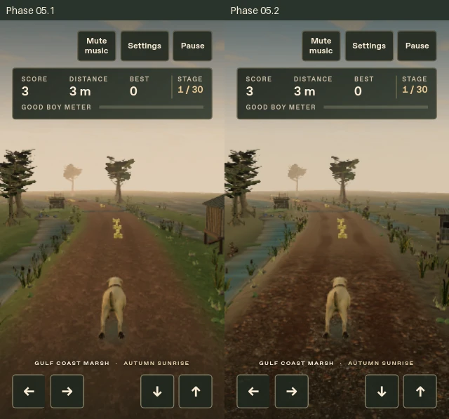

# Gulf Coast Marsh visual review

The six pairs were captured from the built game with the normal rear camera in a 320 × 568 portrait viewport. Each pair uses seed 7, Balanced, matched distance and autumn sunrise. Tap an image for the full-width comparison. Phase 05.1 `e21de57` is on the left. Phase 05.2 `034aa90` is on the right. The review build `81dec1d` extends its coastal shader through the Cypress blend beyond these cameras.

| Paired camera | Review |
| --- | --- |
| [Opening, 3 m](opening.webp) | Foreground texture and shoulder seams |
| [Raised shelter, 170 m](raised-shelter.webp) | Pilotis, broad shooting slot, exposure and the supported tree in the lane |
| [Creek approach, 27 m](creek-bank.webp) | Jumpable crossing width and the first shallow bank |
| [Near bank, 34 m](decoy-water.webp) | Surface detail close to the channel and the darker pond color |
| [Cordgrass, 79 m](cordgrass-shore.webp) | Shore clustering and foreground hazard contrast |
| [Marsh horizon, 149 m](marsh-horizon.webp) | Open marsh, reflection and shelter silhouette at a distance |

[Battery Saver, Balanced and High at 79 m](graphics-presets.webp) · [Interrupted Gulf map](interrupted-download.webp) · [Cypress after Gulf map release](cypress-release.webp) from the accelerated streaming fixture on `81dec1d`.

[Fallback mallard approach](mallard-approach.webp) · [Fallback mallard near bank](mallard-animal.webp). Seed 14 uses the same three birds and path in both builds. The earlier Phase 05.2 art candidate `056eaf3` supplied the bird renders and preset comparison.

## Moving gameplay

The two excerpts capture the ordinary game clock and same guided inputs at 320 × 568 in software Chromium. Use them to inspect moving silhouettes, trail detail and passage through the first obstacles. Physical iPhone frame pacing requires a device trace. [Phase 05.1 clip](gameplay-before.mp4) · [Phase 05.2 clip](gameplay-after.mp4)

## Blender studies

These are headless Eevee renders of the authored or derived assets. The game cameras above show their use in the compiled app. [Raised shelter](shelter-study.webp) · [Cattail close geometry](cattail-study.webp) · [Decimated driftwood](driftwood-study.webp) · [Mallard drake body](mallard-study.webp) · [Packed surface color swatches](surface-study.webp)

The [Labrador shoulder and Boyd rig study](dog-rig-study.webp) compares the shipped Labrador, the reversible bind-space shoulder experiment and the shipped Boyd derivative in the same lighting and pose. It uses the built GLBs. The experiment stays separate from the runtime character.

[Implementation, measurements and owner checks](../../PHASE_05_2_REPORT.md)
