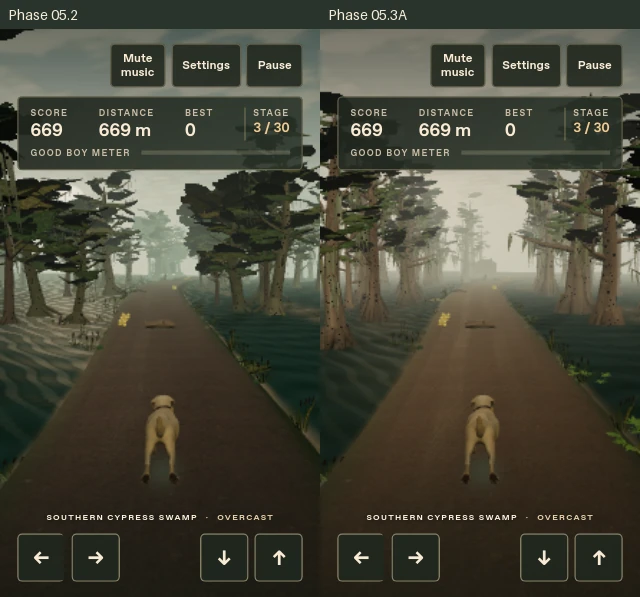

# Southern Cypress Swamp visual review

Each pair shows the built Phase 05.2 game on the left and the built Phase 05.3A game on the right. WebKit captured both at 320 × 568 in Balanced with seed 7, the same trail distance and the same weather. Tap for the full comparison.

| Scene | Detail to compare |
| --- | --- |
| [Swamp entry, 481 m](swamp-entry.webp) | Tall trunks framing the lane and distant canopy layers |
| [Camp approach, 474 m](hunting-camp.webp) | Raised camp and timber landing in the left clearing |
| [Flooded grove, 669 m](flooded-grove.webp) | Flared trunks, dark pools and the softer reflection |
| [Moss corridor, 845 m](moss-corridor.webp) | Irregular branches, hanging moss and legible obstacle silhouettes in overcast light |

The moving clip is normal-clock gameplay with guided inputs through the existing controls. It uses the built game in Linux WebKit and preserves the portrait camera. [Moving swamp gameplay](swamp-run.mp4)

[Implementation and measurements](../../PHASE_05_3A_REPORT.md)
